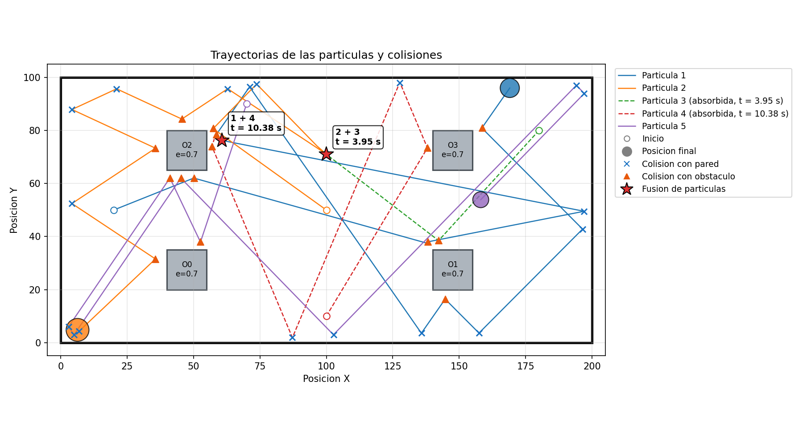
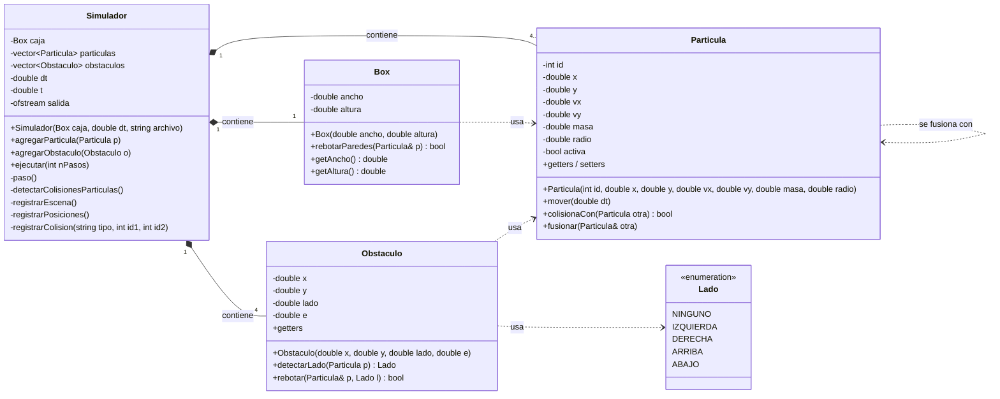
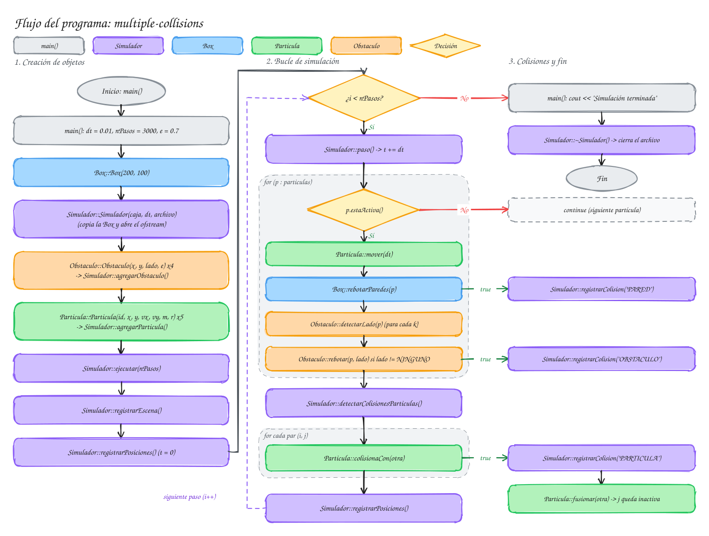

# Simulación de colisiones múltiples

Práctica 5 – Informática II, Universidad de Antioquia. Actividad 2.1.

Simulación en tiempo discreto de *n* partículas circulares dentro de una caja rectangular con 4 obstáculos cuadrados estáticos. Se modelan tres tipos de colisión:

| Colisión | Tipo | Modelo |
|---|---|---|
| Partícula – pared | Perfectamente elástica | Se invierte la componente de la velocidad perpendicular a la pared |
| Partícula – obstáculo | Inelástica (coef. `e`) | `v⊥' = -e·v⊥`, `v∥' = v∥` según el lado del cuadrado impactado |
| Partícula – partícula | Completamente inelástica | Se fusionan: `M = m1 + m2`, `v' = (m1·v1 + m2·v2) / M` |

## Compilación

Proyecto CMake (C++17). Se abre en Qt Creator o se compila con:

```bash
cmake -S . -B build
cmake --build build
```

Al ejecutarlo se genera `simulacion.txt` en el directorio de trabajo.

## Formato del archivo de salida

```
CAJA ancho altura
OBS  k x y lado e
POS  t id x y radio
COL  t tipo id1 id2
```

- `tipo` puede ser `PARED`, `OBSTACULO` o `PARTICULA`.
- `id2` es `-1` para pared, el índice del obstáculo o el id de la otra partícula.

## Gráfica de resultados

El script [`graficar.py`](graficar.py) (Python + matplotlib) lee el archivo de salida y dibuja la caja, los obstáculos, la trayectoria de cada partícula y el punto donde ocurrió cada colisión:

```bash
pip install matplotlib
python graficar.py simulacion.txt trayectorias.png --mostrar
```

Resultado de una corrida de ejemplo ([`resultados/simulacion.txt`](resultados/simulacion.txt)): 5 partículas, 30 s, `dt = 0.01 s`, `e = 0.7`.



| Colisiones | Cantidad |
|---|---|
| Con paredes | 18 |
| Con obstáculos | 15 |
| Entre partículas (fusiones) | 2 |

## Verificación del momento lineal

En cada fusión el programa imprime en consola el momento total antes y después del choque, para comprobar que se cumple `m1·v1 + m2·v2 = (m1 + m2)·v'`:

```
t = 3.95 s  fusion 2 + 3  |  p antes = (-42.5, 28.2)  p despues = (-42.5, 28.2)  ->  diferencia = (0, 0)
t = 10.38 s  fusion 1 + 4  |  p antes = (-48.975, 49.26)  p despues = (-48.975, 49.26)  ->  diferencia = (0, 0)
```

## Diagrama de clases



## Diagrama de flujo

Cada caja indica la función que se llama y la clase a la que pertenece (`Clase::funcion()`); el color identifica la clase.



El diagrama es editable: abre [`docs/flujo.excalidraw`](docs/flujo.excalidraw) en [excalidraw.com](https://excalidraw.com) (menú → Abrir).

## Simplificaciones

- Solo se aplica un rebote si la partícula se mueve hacia la pared u obstáculo, para evitar rebotes dobles en un mismo choque.
- En un choque contra la esquina de un obstáculo se toma el lado con menor penetración.
- Al fusionarse dos partículas, el nuevo cuerpo se ubica en el centro de masa y su radio conserva el área: `r = √(r1² + r2²)`. La partícula absorbida queda inactiva.
