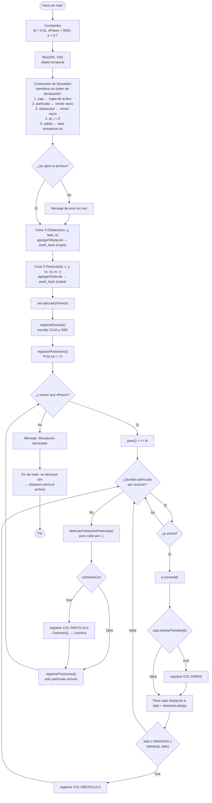

# Simulación de colisiones múltiples

Práctica 5 – Informática II, Universidad de Antioquia. Actividad 2.1.

Simulación en tiempo discreto de *n* partículas circulares dentro de una caja rectangular con 4 obstáculos cuadrados estáticos. Se modelan tres tipos de colisión:

| Colisión | Tipo | Modelo |
|---|---|---|
| Partícula – pared | Perfectamente elástica | Se invierte la componente de la velocidad perpendicular a la pared |
| Partícula – obstáculo | Inelástica (coef. `e`) | `v⊥' = -e·v⊥`, `v∥' = v∥` según el lado del cuadrado impactado |
| Partícula – partícula | Completamente inelástica | Se fusionan: `M = m1 + m2`, `v' = (m1·v1 + m2·v2) / M` |

## Compilación

Proyecto CMake (C++17). Se abre en Qt Creator o se compila con:

```bash
cmake -S . -B build
cmake --build build
```

Al ejecutarlo se genera `simulacion.txt` en el directorio de trabajo.

## Formato del archivo de salida

```
CAJA ancho altura
OBS  k x y lado e
POS  t id x y radio
COL  t tipo id1 id2
```

- `tipo` puede ser `PARED`, `OBSTACULO` o `PARTICULA`.
- `id2` es `-1` para pared, el índice del obstáculo o el id de la otra partícula.

## Diagrama de clases


## Diagrama de flujo



## Simplificaciones

- Solo se aplica un rebote si la partícula se mueve hacia la pared u obstáculo, para evitar rebotes dobles en un mismo choque.
- En un choque contra la esquina de un obstáculo se toma el lado con menor penetración.
- Al fusionarse dos partículas, el nuevo cuerpo se ubica en el centro de masa y su radio conserva el área: `r = √(r1² + r2²)`. La partícula absorbida queda inactiva.
